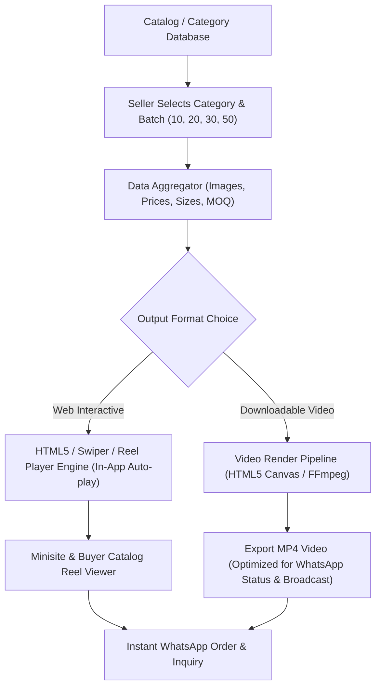
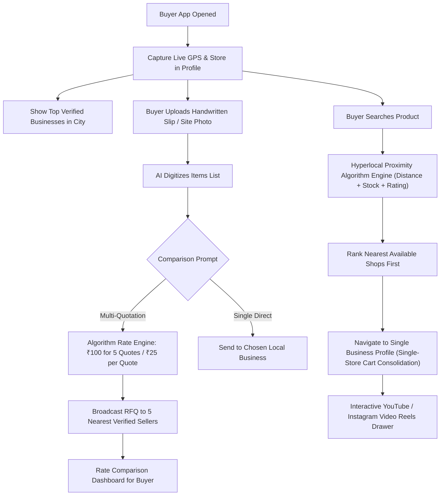

# 🚀 VyaparIndia Product & Feature Roadmap

## 🎬 [Upcoming Feature] Category-Wise Automated Product Video & Carousel Showcase Engine
> **Status:** Planned / Feature Roadmap  
> **Target Audience:** B2B Wholesale Sellers, Retail Buyers, Sales Agents, WhatsApp Catalog Marketing

---

### 1. Vision & Core Objective (मकसद और सोच)
VyaparIndia par har category (jaise CPVC, UPVC, SWR, Sanitary, Electricals, Hardware, Paints) me hazaron products aur unke cards bante hain. 
Traditional B2B buyers lambi lists ya pdf scroll karne ke bajaye **visual video reels aur dynamic carousels** dekhna zyada pasand karte hain.

Yeh feature seller ke live product cards me se **10, 20, 30 ya 50 products ko automatically select karke** unka **video-type animated carousel ya MP4 video presentation** taiyar karega, jisse:
1. Seller apni category ka 30-60 second ka video catalog bina kisi video editor ke 1-click me generate kar sake.
2. Buyer ko TikTok/Instagram Reel style me category ke top products swipe/autoplay me dikhein.
3. WhatsApp broadcast aur marketing me seedha shareable product video bheja ja sake.

---

### 2. Key Capabilities & User Experience (प्रमुख फीचर्स)

#### 🔹 A. Smart Batch Product Selector (10, 20, 30, 50 Items)
* **Category-Wise Filter:** User koi bhi category chune (e.g. *CPVC Fittings*, *Water Tanks*, *Bathroom & Sanitary*).
* **Batch Quantity Chips:** Quick buttons `[ Top 10 ]`, `[ Top 20 ]`, `[ Top 30 ]`, `[ Top 50 ]`, ya `[ Custom Multi-Select ]`.
* **Smart Ordering:**
  - *Best Sellers First*
  - *Highest Discount / Offer Items*
  - *Size-wise ascending (1/2" to 2")*
  - *Recently Added*

#### 🔹 B. Dynamic Presentation Formats
1. **📱 Interactive Reel / Carousel View (Web & App):**
   - 9:16 Vertical Story / Reel format.
   - Smooth 2-3 second auto-slide transition with pause-on-hover / tap-to-pause.
   - Live clickable overlay: Product Name, Brand badge, Available Sizes, MRP & Wholesale Rate, aur "Order / Inquiry Now" button.
2. **🎥 Automated MP4 Video Generator (WhatsApp Shareable):**
   - HTML5 Canvas / WebCodecs / Server-side FFmpeg pipeline.
   - High-definition MP4 format (optimized for WhatsApp 16MB limit, typically 5-10MB).
   - Product photo smooth zoom/pan (Ken Burns effect) + stylish lower-third price cards.
3. **🔄 Horizontal 3D Product Carousel:**
   - Website storefront aur store minisite par category header me chalne wala high-speed auto-sliding 3D card deck.

#### 🔹 C. Card Overlay & Branding Customization
* **Seller Store Branding:** Seller ka logo, shop name, aur VyaparIndia verified badge.
* **Pricing & Discount Slabs:** MRP, Wholesale Selling Rate, aur "Save ₹XX" highlight badge.
* **Size Grid Tag:** Product ke sabhi available sizes (jaise 1/2", 3/4", 1", 1.25", 1.5", 2").
* **Call To Action (CTA):** "Scan to Order" QR code aur seller ka direct WhatsApp click-to-chat button.

#### 🔹 D. Transitions & Audio Presentation
* Multiple transition themes: *Modern Slide*, *Smooth Fade*, *3D Flip*, *Zoom Pop*.
* Optional B2B royalty-free audio tracks (Upbeat Corporate, Wholesale Festive Beats).
* Future AI Voiceover: AI text-to-speech jo audio me bole: *"Plasto CPVC Heavy Duty Fittings ab wholesale rate par uplabdh"*.

---

### 3. Technical Architecture & Implementation Pipeline

---

### 4. Step-by-Step Phased Roadmap (कब और कैसे बनेगा)

| Phase | Milestone | Scope & Deliverables |
|---|---|---|
| **Phase 1** | **Interactive Web Reels & Carousel** | Product cards se category-wise 10-50 items ka in-browser auto-play vertical reel viewer, swipe gesture, touch controls aur live order button. |
| **Phase 2** | **1-Click WhatsApp Video Generator (MP4)** | In-browser client/server canvas recorder jo selected cards ko 30-45 sec HD MP4 video me convert karke instant download provide kare. |
| **Phase 3** | **AI Voiceover & Animated Theme Templates** | Festive templates (Diwali Wholesale Dhamaka, Monsoon Offer) + AI Voice narration announcing products and rates. |

---

### 5. Benefits for VyaparIndia Sellers & Buyers
* **Zero Graphic/Video Editing Skills Required:** Chhota dukandar ya wholesale dealer bina kisi video editor ke apne products ka professional promo video 10 second me bana lega.
* **5x Higher Engagement on WhatsApp:** Static excel sheet ya 30 alag photos bhejne ke bajaye 1 compact reel video bhejna buyers ko zyada pasand aata hai.
* **Instant Category Exploration:** Buyer ko poori category ke saare best products 1 minute ke video me dikh jayenge.

---

## 🌐 [Main Consumer & Buyer App Architecture] Hyperlocal Proximity Discovery, Multi-Quotation RFQ & Modular Algorithm Engine

> **Document Type:** Core Architecture Specification & Modular Algorithm Roadmap  
> **Target Scope:** Customer & Buyer Facing Marketplace (Web, Android & iOS Native App)  
> **Key USP:** Hyperlocal GPS Proximity, Single-Store Cart Consolidation, AI Hardware Photo RFQ & Quotation Monetization

---

### 1. Architectural Philosophy: Decoupled & Modular Algorithm Engine
Aapke nirdesh anusaar, jab main customer application ka launch hoga, to saare ranking, distance calculation, seller scoring, aur quotation pricing rules **ek alag modular algorithm file/service layer** (`app/Services/Algorithms/MarketplaceAlgorithmEngine.php` aur `config/marketplace_algorithm.php`) me rakhe jayenge.
* **Zero Hardcoding:** Kisi bhi radius, distance multiplier, discount weight ya quotation fee ko hardcode nahi kiya jayega.
* **Admin Tunable:** Admin Dashboard se dynamic parameters (jaise ₹100 for 5 quotations ya ₹25 per quotation, search radius 5km/15km/50km) ko kisi bhi waqt bina code badle adjust kiya ja sakega.

---

### 2. Core Modules & User Journeys (मुख्य फीचर्स व कार्यप्रणाली)

#### 📍 Module A: Live GPS-Based Location Engine & Buyer Profile
1. **Accurate GPS Geo-tagging:**
   * Jab buyer app kholega, system HTML5 Geolocation / Native GPS se device ki live `latitude`, `longitude`, `city`, `pincode`, aur `locality` capture karke buyer profile me store karega.
   * Buyer ko multi-address capability milegi: *Current GPS Location*, *Saved Site/Godown Address*, ya *City Selector*.
2. **City-Wise Top Businesses Showcase:**
   * Buyer ke GPS location ke hisab se home screen par uski specific city/market ke **Top Verified Businesses & Wholesale Hubs** highlight honge.
   * Ranking metrics: *Verified GST badge*, *Stock Volume*, *Fulfillment Rate*, aur *Customer Rating*.

#### 🔍 Module B: Hyperlocal Nearest Product Search (सबसे करीब की दुकान पहले)
1. **Geospatial Proximity Query:**
   * Jab buyer kisi product ko search karega (jaise *"1 inch CPVC Tee"*, *"Wall Mixer"*, *"Polycab 2.5mm Wire"*), algorithm search index me matching items search karega.
   * Result sorting formula:
     $$\text{Final Score} = w_1 \times \frac{1}{\text{Distance (km)}} + w_2 \times \text{In-Stock Status} + w_3 \times \text{Price Competitiveness} + w_4 \times \text{Seller Rating}$$
   * Sabse kareeb (nearest shop within 2km, 5km, 15km) jahan wo item stock me uplabdh hai, wo sabse upar dikhega.
2. **Seamless Store Profile & Cart Consolidation:**
   * Jaise hi buyer us product card par click karega, wo seedha **us specific business ke full profile/catalog page** par land karega.
   * **Single-Store Cart Benefit:** B2B aur hardware buyers alag-alag 10 dukano se 1-1 item mangwane ke bajaye ek hi dukan se poora order lena chahte hain taaki local delivery/tempo ek hi baar me ho sake. Buyer usi seller ki profile se baaki fitting aur items cart me jod sakega.

#### 📝 Module C: Hardware & Custom Photo Parchi Order / Multi-Quotation RFQ Engine
1. **Photo / Handwritten Slip Upload:**
   * Hardware, electrical, plumbing aur sanitary me aksar mistri ya customer parchi par pencil se saman likhte hain ya site ki photo bhejte hain.
   * Buyer apni handwritten parchi ya item photo app me upload karega.
   * OCR / AI Vision us parchi ko ek neat itemized bill / request for quotation (RFQ) me convert karega.
2. **Direct Business Routing:**
   * Buyer apni pasandida local shop ko ye quotation list direct bhej sakega.
3. **5-Shop Multi-Quotation Matchmaker (Revenue & Monetization Engine):**
   * Jaise hi list banegi, system buyer ko ek smart prompt dega:
     > *"💡 Kya aap chahte hain ki ye quotation aapke area ke 5 aur verified wholesale dukaano ko bhejkar sabse sasta rate compare karwaya jaye?"*
   * **Flexible Quotation Pricing Engine:**
     - Option A: **Flat Slab Pack:** e.g. ₹100 me 5 Verified Quotations.
     - Option B: **Per-Quotation Micro-fee:** e.g. ₹25 per extra quotation.
   * Sellers ko notification aayega, wo apna best quotation rate submit karenge, aur buyer ko 1 comparison table me sabhi ke rates dikhenge jahan se wo sabse saste seller ko order confirm kar sakega.

#### 🎥 Module D: Seller Social Profile & Video Reels Integration
1. **YouTube Shorts & Instagram Reels Embedding:**
   * Seller apne dashboard se apne showroom, factory, ya new product stock ke **YouTube Shorts URLs** ya **Instagram Reels URLs** paste kar sakega.
2. **Engaging Video Showcase on Business Profile:**
   * Seller ke public profile par ek stylish **"Watch Store Reels"** tab dikhega.
   * Buyer bina YouTube ya Instagram app khole VyaparIndia app ke andar hi full-screen vertical swipe format me unke product video demos dekh sakega aur direct video ke neeche se item add-to-cart kar sakega.

---

### 3. Algorithm Engine Flow Diagram

---

### 4. Implementation Phasing Strategy

| Milestone | Target Component | Key Deliverables |
|---|---|---|
| **Phase 1** | **Modular Algorithm Core** | `config/marketplace_algorithm.php` + `MarketplaceAlgorithmEngine.php` with dynamic weights, radius filters, and quotation pricing constants. |
| **Phase 2** | **Buyer GPS & Proximity Search** | Live geolocation capture, spatial database indexing, nearest-shop-first search query API, and business profile deep-linking. |
| **Phase 3** | **Hardware Parchi & Multi-Quotation Engine** | Image/parchi upload UI, AI digitization, 5-shop quotation broadcast workflow, and ₹100/₹25 payment/credit trigger. |
| **Phase 4** | **Seller Video Reels Showcase** | Seller dashboard reel URL manager (YouTube Shorts & IG Reels) + consumer-facing vertical reel player with instant order buttons. |

