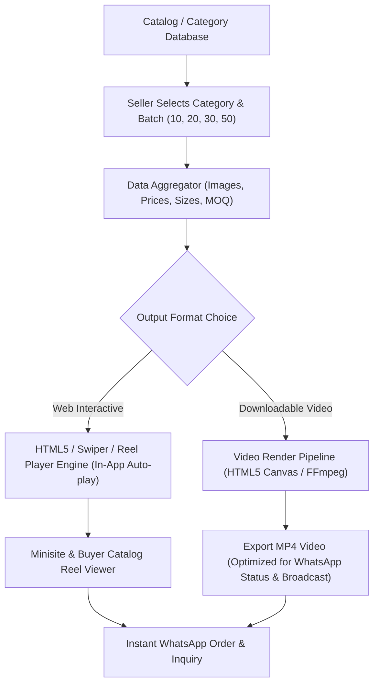

# 🚀 VyaparIndia Product & Feature Roadmap

## 🎬 [Upcoming Feature] Category-Wise Automated Product Video & Carousel Showcase Engine
> **Status:** Planned / Feature Roadmap  
> **Target Audience:** B2B Wholesale Sellers, Retail Buyers, Sales Agents, WhatsApp Catalog Marketing

---

### 1. Vision & Core Objective (मकसद और सोच)
VyaparIndia par har category (jaise CPVC, UPVC, SWR, Sanitary, Electricals, Hardware, Paints) me hazaron products aur unke cards bante hain. 
Traditional B2B buyers lambi lists ya pdf scroll karne ke bajaye **visual video reels aur dynamic carousels** dekhna zyada pasand karte hain.

Yeh feature seller ke live product cards me se **10, 20, 30 ya 50 products ko automatically select karke** unka **video-type animated carousel ya MP4 video presentation** taiyar karega, jisse:
1. Seller apni category ka 30-60 second ka video catalog bina kisi video editor ke 1-click me generate kar sake.
2. Buyer ko TikTok/Instagram Reel style me category ke top products swipe/autoplay me dikhein.
3. WhatsApp broadcast aur marketing me seedha shareable product video bheja ja sake.

---

### 2. Key Capabilities & User Experience (प्रमुख फीचर्स)

#### 🔹 A. Smart Batch Product Selector (10, 20, 30, 50 Items)
* **Category-Wise Filter:** User koi bhi category chune (e.g. *CPVC Fittings*, *Water Tanks*, *Bathroom & Sanitary*).
* **Batch Quantity Chips:** Quick buttons `[ Top 10 ]`, `[ Top 20 ]`, `[ Top 30 ]`, `[ Top 50 ]`, ya `[ Custom Multi-Select ]`.
* **Smart Ordering:**
  - *Best Sellers First*
  - *Highest Discount / Offer Items*
  - *Size-wise ascending (1/2" to 2")*
  - *Recently Added*

#### 🔹 B. Dynamic Presentation Formats
1. **📱 Interactive Reel / Carousel View (Web & App):**
   - 9:16 Vertical Story / Reel format.
   - Smooth 2-3 second auto-slide transition with pause-on-hover / tap-to-pause.
   - Live clickable overlay: Product Name, Brand badge, Available Sizes, MRP & Wholesale Rate, aur "Order / Inquiry Now" button.
2. **🎥 Automated MP4 Video Generator (WhatsApp Shareable):**
   - HTML5 Canvas / WebCodecs / Server-side FFmpeg pipeline.
   - High-definition MP4 format (optimized for WhatsApp 16MB limit, typically 5-10MB).
   - Product photo smooth zoom/pan (Ken Burns effect) + stylish lower-third price cards.
3. **🔄 Horizontal 3D Product Carousel:**
   - Website storefront aur store minisite par category header me chalne wala high-speed auto-sliding 3D card deck.

#### 🔹 C. Card Overlay & Branding Customization
* **Seller Store Branding:** Seller ka logo, shop name, aur VyaparIndia verified badge.
* **Pricing & Discount Slabs:** MRP, Wholesale Selling Rate, aur "Save ₹XX" highlight badge.
* **Size Grid Tag:** Product ke sabhi available sizes (jaise 1/2", 3/4", 1", 1.25", 1.5", 2").
* **Call To Action (CTA):** "Scan to Order" QR code aur seller ka direct WhatsApp click-to-chat button.

#### 🔹 D. Transitions & Audio Presentation
* Multiple transition themes: *Modern Slide*, *Smooth Fade*, *3D Flip*, *Zoom Pop*.
* Optional B2B royalty-free audio tracks (Upbeat Corporate, Wholesale Festive Beats).
* Future AI Voiceover: AI text-to-speech jo audio me bole: *"Plasto CPVC Heavy Duty Fittings ab wholesale rate par uplabdh"*.

---

### 3. Technical Architecture & Implementation Pipeline

---

### 4. Step-by-Step Phased Roadmap (कब और कैसे बनेगा)

| Phase | Milestone | Scope & Deliverables |
|---|---|---|
| **Phase 1** | **Interactive Web Reels & Carousel** | Product cards se category-wise 10-50 items ka in-browser auto-play vertical reel viewer, swipe gesture, touch controls aur live order button. |
| **Phase 2** | **1-Click WhatsApp Video Generator (MP4)** | In-browser client/server canvas recorder jo selected cards ko 30-45 sec HD MP4 video me convert karke instant download provide kare. |
| **Phase 3** | **AI Voiceover & Animated Theme Templates** | Festive templates (Diwali Wholesale Dhamaka, Monsoon Offer) + AI Voice narration announcing products and rates. |

---

### 5. Benefits for VyaparIndia Sellers & Buyers
* **Zero Graphic/Video Editing Skills Required:** Chhota dukandar ya wholesale dealer bina kisi video editor ke apne products ka professional promo video 10 second me bana lega.
* **5x Higher Engagement on WhatsApp:** Static excel sheet ya 30 alag photos bhejne ke bajaye 1 compact reel video bhejna buyers ko zyada pasand aata hai.
* **Instant Category Exploration:** Buyer ko poori category ke saare best products 1 minute ke video me dikh jayenge.
